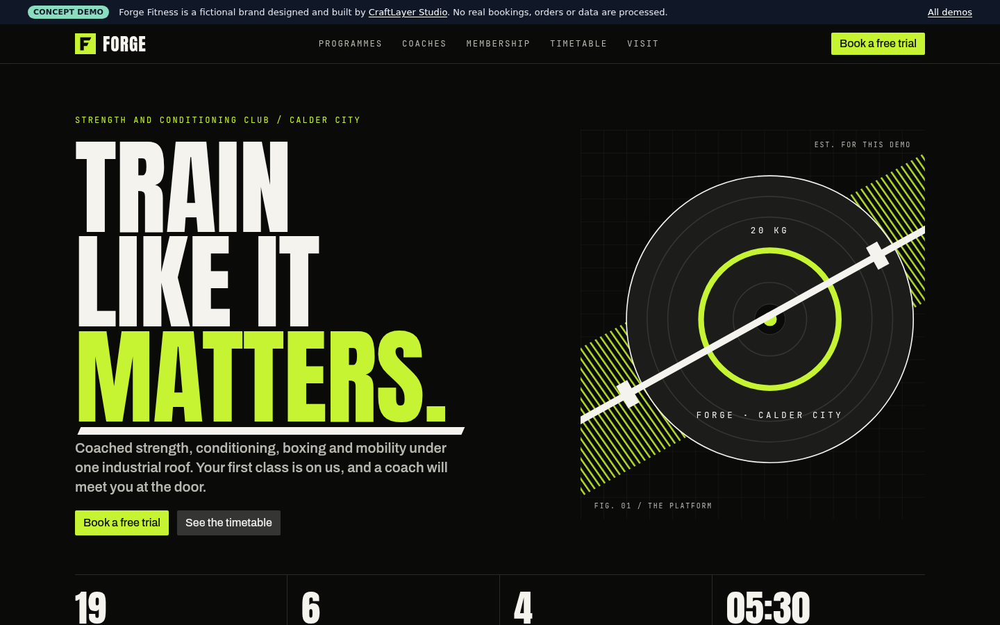
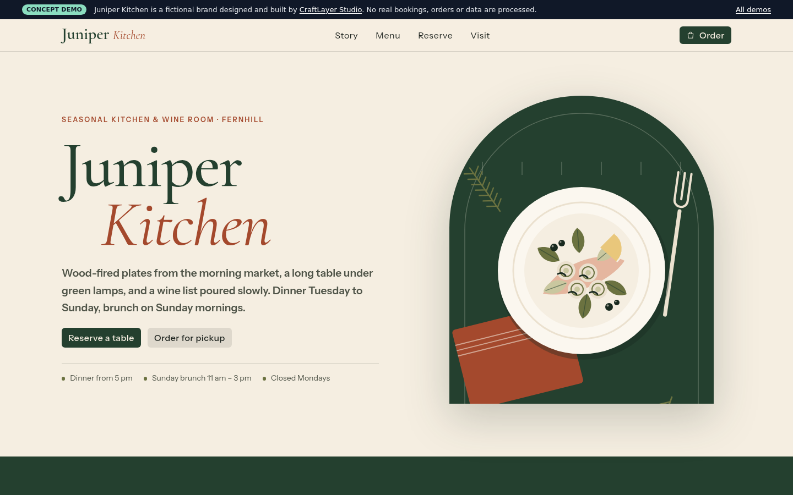
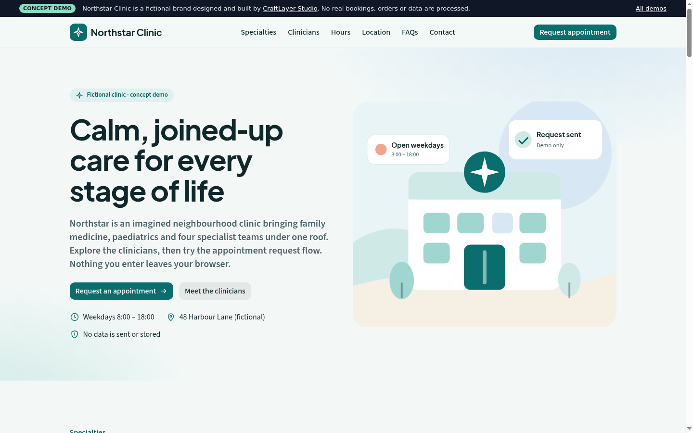
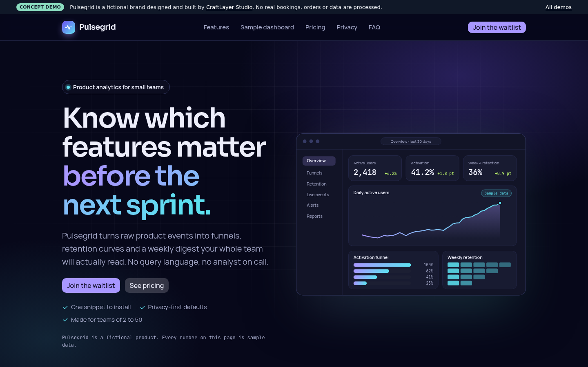
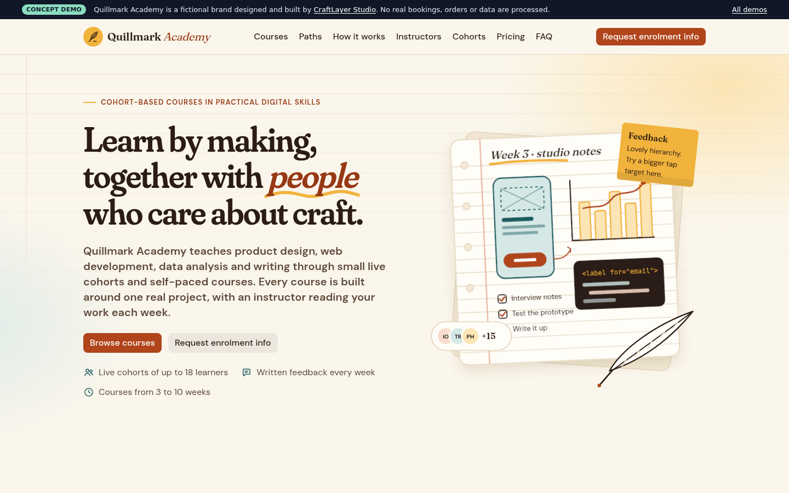
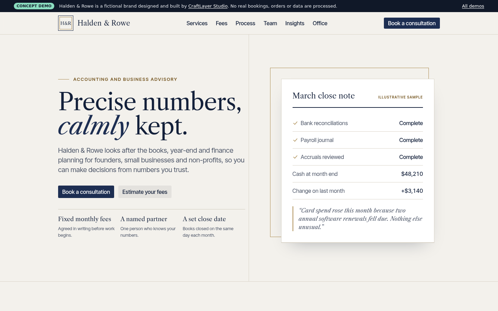
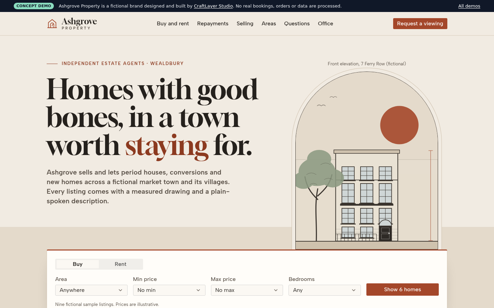
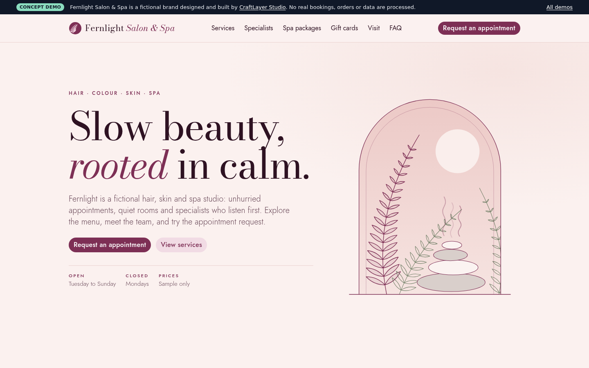
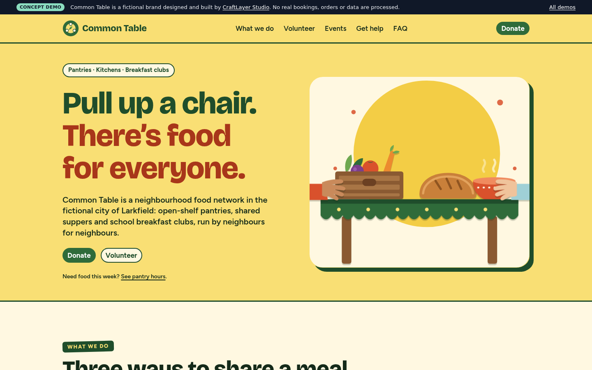
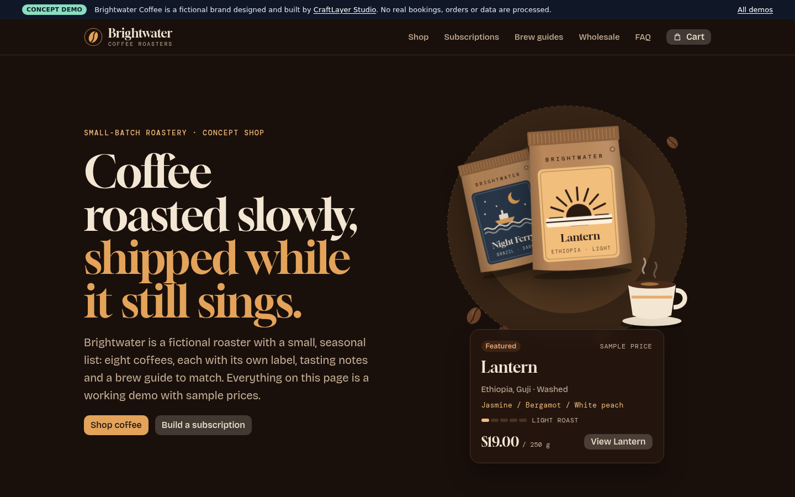

# CraftLayer Studio industry demos

Ten fully working **concept websites** for fictional businesses, designed and engineered by [CraftLayer Studio](https://craftlayer-studio.github.io/) to show how we approach industry websites.

> **Concept demo disclaimer.** Forge Fitness, Juniper Kitchen, Northstar Clinic, Pulsegrid, Quillmark Academy, Halden & Rowe, Ashgrove Property, Fernlight Salon & Spa, Common Table and Brightwater Coffee are fictional brands. They are not CraftLayer clients, they are not real businesses, and every person, address, phone number and price is invented. No bookings, orders, appointments, enquiries, sign-ups, payments or personal data are processed or sent anywhere. Every page shows a "Concept demo" notice.

| Demo | Industry | Live |
|---|---|---|
| **Forge Fitness** | Gym and fitness | https://craftlayer-studio.github.io/industry-demos/gym/ |
| **Juniper Kitchen** | Restaurant and hospitality | https://craftlayer-studio.github.io/industry-demos/restaurant/ |
| **Northstar Clinic** | Healthcare | https://craftlayer-studio.github.io/industry-demos/clinic/ |
| **Pulsegrid** | Startups and SaaS | https://craftlayer-studio.github.io/industry-demos/saas/ |
| **Quillmark Academy** | Education | https://craftlayer-studio.github.io/industry-demos/academy/ |
| **Halden & Rowe** | Professional services | https://craftlayer-studio.github.io/industry-demos/advisory/ |
| **Ashgrove Property** | Real estate | https://craftlayer-studio.github.io/industry-demos/real-estate/ |
| **Fernlight Salon & Spa** | Beauty and wellness | https://craftlayer-studio.github.io/industry-demos/salon/ |
| **Common Table** | Nonprofit | https://craftlayer-studio.github.io/industry-demos/nonprofit/ |
| **Brightwater Coffee** | E-commerce and retail | https://craftlayer-studio.github.io/industry-demos/coffee/ |

Index: https://craftlayer-studio.github.io/industry-demos/

## Screenshots

| Forge Fitness | Juniper Kitchen | Northstar Clinic |
|---|---|---|
|  |  |  |

| Pulsegrid | Quillmark Academy | Halden & Rowe |
|---|---|---|
|  |  |  |

| Ashgrove Property | Fernlight Salon & Spa |
|---|---|
|  |  |

| Common Table | Brightwater Coffee |
|---|---|
|  |  |

## Features

**Forge Fitness** (`/gym/`): bold, dark, athletic brand.
- Programme cards that pre-filter the timetable.
- Class timetable filtered by day, programme and intensity, with an empty state.
- Membership tiers with a monthly/annual switch that recalculates prices.
- Trial booking form: field validation, error summary with focus, a date restricted to the chosen class's weekday, loading and honest demo success states.
- Fictional coaches, original SVG artwork, location and hours.

**Juniper Kitchen** (`/restaurant/`): warm, editorial restaurant brand.
- Menu with category tabs, dietary filters and accent-insensitive search.
- Mock pickup order: cart drawer, quantities, subtotal, illustrative tax, pickup-time and name validation, confirmation that states nothing was ordered or paid.
- Table reservation: open days only, time slots from opening hours, party size 1–12, contact validation.
- Story, gallery of original illustrations, hours and a stylised map.

**Northstar Clinic** (`/clinic/`): calm, clean healthcare brand.
- Specialties and services written without medical claims.
- Fictional clinicians with a working specialty filter.
- Accessible multi-step appointment request: specialty, clinician, weekday date within 60 days, deterministic time slots, minimal contact details, review, demo confirmation. Focus moves to each step heading.
- FAQ accordion, hours, stylised map, and a clear "not a real clinic" warning.

**Pulsegrid** (`/saas/`): dark, product-led SaaS launch page.
- Feature tour with tabs and an illustrative sample dashboard (sample data, labelled as such).
- Pricing calculator and plan comparison table.
- Integrations, security notes, FAQ and a validated waitlist form that sends nothing.

**Quillmark Academy** (`/academy/`): warm, editorial online academy.
- Searchable course catalogue with filters and a course detail dialog.
- Learning paths, cohort calendar, fictional instructors and pricing.
- Validated enrolment enquiry form with demo-only success state.

**Halden & Rowe** (`/advisory/`): restrained accounting and advisory firm.
- Practice areas, process, audiences and insights.
- Fee estimator with illustrative sample pricing, not a quote.
- Fictional team, office with stylised map, FAQ and a multi-step consultation request.

**Ashgrove Property** (`/real-estate/`): warm, architectural estate agency.
- Hero search (buy/rent, area, price range, bedrooms) that filters and sorts nine fictional listings, with an empty state.
- Listing dialog with an original front-elevation drawing and an illustrative floor plan.
- Repayment estimator labelled illustrative, not financial advice; viewing request with weekday dates and time slots.

**Fernlight Salon & Spa** (`/salon/`): soft-luxury salon and spa.
- Tabbed service menu with durations and sample prices; specialist profiles with a filter.
- Spa package comparison and a gift card builder with live preview (nothing is charged).
- Multi-step appointment request: dates exclude Mondays and the specialist's days off, and time slots fit the service inside opening hours.

**Common Table** (`/nonprofit/`): hopeful, poster-like community food network.
- Programmes, and an illustrative "how a gift is used" chart with a data-table alternative. No impact statistics are claimed.
- Donation form (one-off or monthly, preset or custom amount) where no payment is taken.
- Volunteer shift sign-up with role and day filters, events and fictional pantry locations.

**Brightwater Coffee** (`/coffee/`): dark, tactile coffee roaster shop.
- Catalogue filtered by roast, process and tasting notes, with sorting and a product dialog.
- Mock cart drawer with a free-shipping threshold and an honest demo checkout.
- Subscription builder, brew guides with a ratio calculator, and a wholesale enquiry form.

All ten are responsive down to 320px, keyboard accessible, and respect `prefers-reduced-motion`.

## Technology

- Next.js 16.4.6 App Router, React 19.3, TypeScript 5, static export.
- [Meta Astryx](https://github.com/meta/astryx) 0.7.13. Each demo has its own built theme (`src/themes/gym/forge`, `src/themes/restaurant/juniper`, `src/themes/clinic/northstar`, `src/themes/saas/pulsegrid`, `src/themes/academy/quillmark`, `src/themes/advisory/halden`, `src/themes/real-estate/ashgrove`, `src/themes/salon/fernlight`, `src/themes/nonprofit/commontable`, `src/themes/coffee/brightwater`) nested inside its route layout. See `docs/ASTRYX.md`.
- CSS Modules on top of Astryx tokens; fonts self-hosted at build time via `next/font`.
- Vitest + Testing Library for filtering, pricing, cart, scheduling and validation logic.

## Project structure

```text
src/app/page.tsx              demos index
src/app/<demo>/               route layout (metadata, fonts, theme) + page
src/components/shell/         ConceptBar shown on every demo page
src/components/<demo>/        components and pure logic modules with tests
src/themes/<demo>/            Astryx theme sources and built output
src/lib/paths.ts              basePath helper for plain  and static links
```

## Local setup

Requirements: Node.js 20.9+ (22 LTS recommended), pnpm 11.

```bash
pnpm install
pnpm dev            # http://localhost:3000/industry-demos/
pnpm lint && pnpm typecheck && pnpm test
pnpm build          # static export to out/
```

`dev` and `build` use `--webpack` for parity with hosts whose glibc cannot load Turbopack's native bindings. Run one build at a time: concurrent builds share `.next/` and can fail.

To preview the export with the correct base path, serve a directory whose `industry-demos/` folder contains `out/`, for example:

```bash
mkdir -p /tmp/pages/industry-demos && cp -r out/. /tmp/pages/industry-demos/
cd /tmp/pages && python3 -m http.server 4321   # http://localhost:4321/industry-demos/
```

## Deployment configuration

This is a GitHub Pages **project site**, served under `/industry-demos`.

```ts
// next.config.ts
output: 'export', basePath: '/industry-demos', trailingSlash: true, images: {unoptimized: true}
```

`next/link` and `next/image` add the base path automatically. Plain ``, CSS `url()` and links to static files use `asset()` from `src/lib/paths.ts`. `.github/workflows/deploy.yml` installs with a frozen lockfile, runs lint, typecheck, tests and the build, checks that every demo page exists in `out/`, then deploys with `actions/deploy-pages`. A failing check stops the run before deployment.

## Known limitations

- Static hosting only: forms validate in the browser and then stop. Nothing is stored or sent, by design.
- Availability, time slots, prices and opening hours are generated from static data, not a live system.
- Visuals are original SVG illustrations, not photography.
- Maps are stylised illustrations; there are no third-party map embeds.
- The demos sitemap is listed in the main site's `robots.txt`, because a project site's own `robots.txt` is not read by crawlers.

## Licence

Code: MIT (see `LICENSE`). The fictional brand names and copy are provided as portfolio material; the CraftLayer Studio name and logo are not covered by the code licence.
